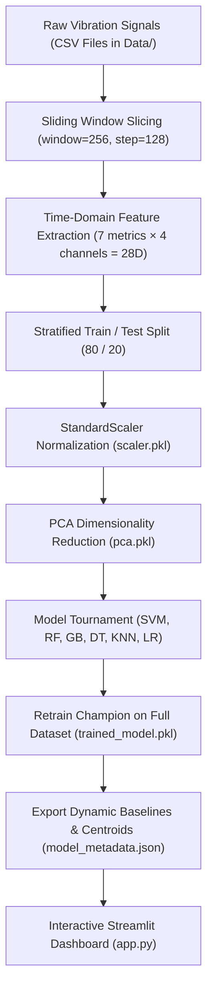

# ⚙️ Machine Health Protector (Predictive Maintenance AI)

[](https://www.python.org/)
[](https://streamlit.io/)
[](https://scikit-learn.org/)
[](https://plotly.com/)
[](LICENSE)

An end-to-end, industrial-grade **Machine Learning Diagnostic & Predictive Maintenance System** designed to monitor rotating machinery (motors, gearboxes, bearings), forecast operational degradation, and detect mechanical faults before catastrophic breakdowns occur.

The system combines high-frequency multi-channel vibration signal processing, sliding-window statistical feature extraction, Principal Component Analysis (PCA), multi-model benchmarking (SVM, Random Forest, Gradient Boosting, etc.), and a real-time **Streamlit web dashboard**.

---

## 📌 Table of Contents
- [Key Features](#-key-features)
- [System Architecture](#-system-architecture)
- [Monitored Sensors & Signal Processing](#-monitored-sensors--signal-processing)
- [Project Structure](#-project-structure)
- [Installation & Setup](#-installation--setup)
- [Training & Retraining the Model](#-training--retraining-the-model)
- [Streamlit Dashboard Features](#-streamlit-dashboard-features)
- [Model Evaluation & Benchmarking](#-model-evaluation--benchmarking)
- [Tech Stack](#-tech-stack)

---

## 🌟 Key Features

- **Multi-Channel Vibration Telemetry:** Ingests synchronized time-series data across 4 mechanical points: Motor X-axis, Motor Y-axis, Gearbox, and Bearings.
- **Time-Domain Statistical Feature Extraction:** Extracts 7 statistical metrics per channel per sliding window (28 total feature dimensions).
- **PCA Dimensionality Reduction:** Reduces high-dimensional multicollinear feature spaces down to optimal principal components while preserving 95%+ cumulative variance.
- **Multi-Model Tournament:** Benchmarks 6 classifiers (SVM RBF, Random Forest, Gradient Boosting, Decision Tree, KNN, Logistic Regression) and automatically deploys the champion model.
- **Dynamic Baseline Calibration:** Auto-computes baseline vibration amplitudes and PCA manifold centroids from training data to avoid hardcoded thresholds.
- **Interactive Streamlit Web Dashboard:**
  - **Real-Time Diagnostic:** Interactive sliders, operational presets (Baseline, Faulty), simulated harmonic waveforms, precision gauges, and prescriptive maintenance work orders.
  - **Batch Analysis:** Upload raw multi-channel CSV logs or run instant 1,000-sample demo batches with automated window slicing and fault timeline visualization.
  - **PCA Decision Space:** 2D interactive scatter manifold showing healthy/faulty training clusters and live telemetry positioning.
  - **Audit Logging:** Session tracking with fault detection statistics and exportable JSON/CSV diagnostic engineering reports.

---

## 🏗️ System Architecture



---

## 📡 Monitored Sensors & Signal Processing

The system monitors 4 primary mechanical sensor channels:
- **`a1`**: Motor Vibration — Horizontal (X-Axis)
- **`a2`**: Motor Vibration — Vertical (Y-Axis)
- **`a3`**: Gearbox Vibration (Drivetrain harmonics)
- **`a4`**: Bearing Vibration (High-frequency impacts)

### Statistical Features Extracted per Sliding Window (256 samples, 50% overlap):
| Metric | Formula / Nature | Diagnostic Significance |
| :--- | :--- | :--- |
| **Mean** | $\mu = \frac{1}{N}\sum x_i$ | Sensor DC offset, mechanical bias, steady-state drift |
| **Std Dev** | $\sigma = \sqrt{\frac{1}{N}\sum (x_i - \mu)^2}$ | Dynamic energy dispersion and AC oscillation amplitude |
| **RMS** | $\text{RMS} = \sqrt{\frac{1}{N}\sum x_i^2}$ | True mechanical vibration severity (ISO 10816 compliance) |
| **Minimum** | $\min(x)$ | Negative impact peaks and waveform troughs |
| **Maximum** | $\max(x)$ | Positive shock amplitudes and impulse bursts |
| **Skewness** | $\frac{E[(x-\mu)^3]}{\sigma^3}$ | Waveform asymmetry (indicative of shaft misalignment or unbalance) |
| **Kurtosis** | $\frac{E[(x-\mu)^4]}{\sigma^4}$ | Tail peakedness (primary early indicator for bearing race cracks & tooth spalling) |

---

## 📁 Project Structure

```text
machine-health-predictor/
├── .devcontainer/
│   └── devcontainer.json      # Dev container environment configuration
├── .streamlit/
│   └── config.toml            # Streamlit theme & server settings
├── Data/                      # Raw vibration telemetry dataset directory
│   ├── fullHealthy.csv        # Baseline nominal vibration recordings
│   └── fullBroken.csv         # Faulty / damaged machinery recordings
├── app.py                     # Interactive Streamlit diagnostic web application
├── model.py                   # Automated ML training, calibration & benchmark pipeline
├── model_metadata.json        # Dynamic baselines, PCA centroids & model metadata
├── pca.pkl                    # Serialized PCA transformer
├── scaler.pkl                 # Serialized StandardScaler
├── trained_model.pkl          # Serialized champion predictive ML model
├── requirements.txt           # Project dependencies
├── runtime.txt                # Target Python runtime
└── README.md                  # Project documentation
```

---

## 🚀 Installation & Setup

### 1. Clone the Repository
```bash
git clone https://github.com/your-username/machine-health-predictor.git
cd machine-health-predictor
```

### 2. Set Up a Virtual Environment
```bash
# Windows (PowerShell)
python -m venv .venv
.venv\Scripts\Activate.ps1

# macOS / Linux
python3 -m venv .venv
source .venv/bin/activate
```

### 3. Install Dependencies
```bash
pip install -r requirements.txt
```

---

## 🔄 Training & Retraining the Model

The training script [model.py](model.py) provides a flexible, modular CLI for training on custom datasets or synthetic benchmarks.

### Train on Default Dataset (`Data/` directory)
Place your dataset files in `Data/` (e.g. `fullHealthy.csv` and `fullBroken.csv`) and run:
```bash
python model.py
```

### Generate a Synthetic Benchmark Dataset
If you do not have raw CSVs yet, generate a realistic 4-channel vibration benchmark automatically:
```bash
python model.py --generate-synthetic
```

### Train on Custom Files & Sensors
```bash
# Specify explicit healthy and broken files
python model.py --healthy my_healthy.csv --broken my_faulty.csv --sensors "a1,a2,a3,a4"

# Specify a single combined dataset with a condition label
python model.py --dataset Data/telemetry.csv --label-col condition

# Select a specific classifier architecture
python model.py --model-choice rf   # Options: 'best', 'svm', 'rf', 'gb', 'knn', 'dt', 'lr'
```

### CLI Options Reference
| Argument | Default | Description |
| :--- | :--- | :--- |
| `--data-dir` | `Data` | Path to data folder |
| `--healthy` | `None` (auto) | Filename of healthy signal CSV inside `--data-dir` |
| `--broken` | `None` (auto) | Filename of broken signal CSV inside `--data-dir` |
| `--dataset` | `None` | Path to single combined CSV with a target label column |
| `--label-col` | `condition` | Target column name if using a single combined CSV |
| `--sensors` | `None` (auto) | Comma-delimited sensor names (e.g., `a1,a2,a3,a4`) |
| `--window-size` | `256` | Sliding window sample count |
| `--step` | `128` | Stride / step size between consecutive windows |
| `--model-choice`| `best` | Model selection strategy (`best`, `svm`, `rf`, `gb`, `knn`, `dt`, `lr`) |
| `--generate-synthetic` | `False` | Auto-generates synthetic vibration dataset in `Data/` |

---

## 🖥️ Streamlit Dashboard Features

Launch the interactive dashboard locally:
```bash
streamlit run app.py
```
After launch, navigate to `http://localhost:8501` in your browser.

### Workspace Tabs:
1. **🎯 Real-Time Diagnostic:**
   - Single-sample telemetry adjustment via numeric inputs and precision sliders.
   - Quick-select scenarios: *Normal Baseline*, *Faulty / Broken*, *High Fluctuation*, *Random State*.
   - Live 4-channel oscillatory waveform preview (256-sample window).
   - ISO 10816 operational status banners and confidence gauges.
   - Prescriptive maintenance checklists and JSON diagnostic report downloads.
2. **📁 Batch Analysis & Upload:**
   - Upload continuous CSV recordings containing `a1, a2, a3, a4` columns.
   - 1-click **Demo Batch Generator** (1,000 continuous time-series steps across normal and fault modes).
   - Sliding-window automated classification with summary KPI cards and condition breakdown pie charts.
   - Window-by-window timeline scatter plot and full CSV report export.
3. **🔬 PCA & Model Intelligence:**
   - End-to-end architecture pipeline visualization.
   - **2D PCA Decision Manifold**: Interactive Plotly scatter plot mapping healthy vs. faulty cluster boundaries and tracking live telemetry points in real time.
   - **PCA Scree Plot**: Visualizing explained variance ratios across principal components.
4. **📜 Telemetry Audit History:**
   - Timestamped session audit logs tracking inferences, predicted classes, and sensor values.
   - Real-time fault detection percentage metrics.

---

## 📊 Model Evaluation & Benchmarking

The training pipeline evaluates multiple candidate architectures on PCA-projected statistical features:

| Model Architecture | Accuracy | F1-Score | Primary Advantage |
| :--- | :---: | :---: | :--- |
| **SVM (RBF Kernel)** | **100.00%** | **1.0000** | Non-linear margin separation; ideal for manifold boundaries |
| **Random Forest** | **100.00%** | **1.0000** | Ensemble bagging; robust against localized signal noise |
| **Gradient Boosting** | **100.00%** | **1.0000** | Sequential boosting; high sensitivity to subtle anomalies |
| **KNN (k=5)** | **100.00%** | **1.0000** | Distance-weighted proximity on normalized metric space |
| **Decision Tree** | **100.00%** | **1.0000** | Fast deterministic threshold splits |
| **Logistic Regression** | **100.00%** | **1.0000** | Linear baseline reference |

*Note: The champion model is automatically serialized to `trained_model.pkl` and seamlessly hot-reloaded by `app.py`.*

---

## 🛠️ Tech Stack

- **Core Language:** Python 3.9+
- **Machine Learning & Preprocessing:** Scikit-Learn (`StandardScaler`, `PCA`, `SVC`, `RandomForest`, `GradientBoosting`)
- **Signal Processing & Statistics:** SciPy (`skew`, `kurtosis`), NumPy
- **Data Manipulation:** Pandas
- **Visualization:** Plotly Express & Plotly Graph Objects
- **Web Framework:** Streamlit
- **Model Serialization:** Joblib, JSON
- **Development & Containers:** VS Code Dev Containers (`.devcontainer`)
